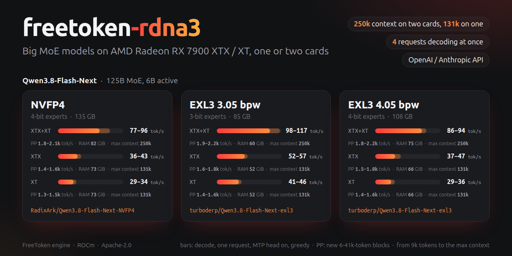

# freetoken-rdna3



**Run Qwen3.8-Flash-Next, a 125B-parameter Mixture-of-Experts model, on your own PC with one or two AMD Radeon RX 7900
XTX / XT cards.** You get a local server with an OpenAI- and Anthropic-compatible API: chat apps, coding agents
(OpenCode, Claude Code) and your own scripts use it like a cloud API, with 262k tokens of context per conversation (up
to 1M with `xtx-xt-1m`), while the model runs on your hardware.

It is a tuned build of the [FreeToken](https://github.com/FlashML-org/FreeToken) MoE engine for RDNA3 (ROCm). The model
does not fit in VRAM: every expert lives in system RAM and the GPUs keep the most used ones; two unequal cards share
the work.

## What you need

| | |
|---|---|
| GPUs | one or two RX 7900 XTX (24 GB) / RX 7900 XT (20 GB); other cards: [which GPUs](docs/rdna3/limits.md#which-gpus) |
| RAM | 128 GB recommended: the server locks ~52 to ~83 GiB, depending on the checkpoint and the number of cards ([table](#which-checkpoint)), more with conversations kept in RAM, and the system and your programs need ~30 GiB beside it ([how to count](docs/rdna3/limits.md#how-much-ram-do-i-need)) |
| Disk | 85 to 135 GB for the model, ~27 GB for the image (~29 GB more while it builds) |
| System | Linux x86_64 with the in-kernel `amdgpu` driver, and Docker. ROCm, PyTorch and the rest come inside the image |

`rdna3/serve.sh --check` looks at your machine, says what is missing, which profile fits your GPUs and what fits in your
RAM. It changes nothing.

## Quick start

```bash
git clone https://github.com/Cedriceuh/freetoken-rdna3 && cd freetoken-rdna3
rdna3/serve.sh --check                                   # what this machine has, which profile fits (no image yet: expected)
docker build -f Dockerfile.rdna3 -t freetoken-rdna3:latest .    # once; pulls a 25 GB ROCm base image
rdna3/download.sh nvfp4                                  # 135 GB into ~/models (or exl3-3.05, exl3-4.05: see below)
rdna3/serve.sh xtx-xt --model ~/models/Qwen3.8-Flash-Next-NVFP4  # use the profile --check suggests
```

The server loads in ~2.5 minutes on the reference machine (the first start of a new image also compiles GPU kernels for
a few minutes). It is
ready when `curl -s http://127.0.0.1:1919/health` answers `"ok"`. Then, from another terminal:

```bash
curl -s http://127.0.0.1:1919/v1/chat/completions -H 'Content-Type: application/json' -d '{
  "model": "qwen3.8-flash-next", "messages": [{"role": "user", "content": "Hello! Who are you?"}],
  "chat_template_kwargs": {"enable_thinking": false}}'
```

Every step explained, with client set-ups and running it as a service:
[docs/rdna3/getting-started.md](docs/rdna3/getting-started.md).

## What you can do with it

- **Chat** from any app that speaks the OpenAI API: base URL `http://127.0.0.1:1919/v1`, model `qwen3.8-flash-next`,
  any API key.
- **Run coding agents**: OpenCode through the OpenAI API (the client every agent measurement here used), or a client
  of the Anthropic API such as Claude Code (`ANTHROPIC_BASE_URL=http://127.0.0.1:1919`; not measured here). Tool calls
  and thinking are supported. On two cards up to four
  requests run at once, so sub-agents work in parallel. Set-ups:
  [connect a client](docs/rdna3/getting-started.md#7-connect-a-client).
- **Work on long inputs**: 262,144 tokens per conversation on two cards, 131,072 on one. With the attention K/V moved
  to RAM, `xtx-xt-4x262k` holds four such conversations at once (three with NVFP4 on 128 GB) and `xtx-xt-1m` one of up to 1M
  tokens; each 262k
  conversation then takes 6.9 GiB of RAM ([long context](docs/rdna3/long-context.md), `rdna3/serve.sh --check`).
- **Switch between conversations**: one pushed off the GPUs is kept in system RAM and resumes in ~2 s instead of being
  read again.
- **Send images** with `rdna3/serve.sh ... --vision` ([images](docs/rdna3/limits.md#images-vision)).
- **Script it** with any OpenAI or Anthropic SDK, or serve your network (`--host 0.0.0.0`, add an API key:
  [security](docs/rdna3/limits.md#anything-else-to-know)).

## Which profile?

A profile holds every setting for one GPU setup; `rdna3/serve.sh <profile>` picks the cards by itself.

| Your GPUs | Profile | Context | Requests at once | Status |
|---|---|---:|---:|---|
| RX 7900 XTX + RX 7900 XT | `xtx-xt` | 262k, shared by the requests | 4 | measured |
| the same, several agents with long conversations (K/V in RAM) | `xtx-xt-4x262k` | 262k each | up to 4, as your RAM allows | measured |
| the same, one conversation past 262k (K/V in RAM) | `xtx-xt-1m` | 1M | 4, sharing 1M | measured with EXL3 3.05 bpw |
| two RX 7900 XTX | `xtx-xtx` | 262k | 4 | untested; EXL3 needs `FREETOKEN_TP_SPLIT=0.6` |
| two RX 7900 XT | `xt-xt` | 262k | 4 | untested; EXL3 needs `FREETOKEN_TP_SPLIT=0.6` |
| one RX 7900 XTX | `xtx` | 131k | 1 | measured |
| one RX 7900 XT | `xt` | 131k | 1 | measured |
| one RX 7900 GRE | `gre` | 65k | 1 | untested |

Untested profiles are derived from the measured ones; the script says so when you start one. Measured one? Please open
an issue with your numbers. Details and adapting a profile to other cards: [profiles](docs/rdna3/profiles.md).

## Which checkpoint?

All three run on `xtx-xt`, `xtx` and `xt` with nothing to change: download one and point `--model` at its directory.
`xtx-xt-1m` is measured with EXL3 3.05 bpw only, `xtx-xt-4x262k` with EXL3 3.05 bpw (four conversations) and NVFP4
(three) ([profiles](docs/rdna3/profiles.md#xtx-xt-4x262k-and-xtx-xt-1m-the-kv-in-host-ram)). "bpw" is bits per weight;
the other terms: [glossary](docs/rdna3/README.md#terms-used-in-these-pages).

| | NVFP4 | EXL3 3.05 bpw | EXL3 4.05 bpw |
|---|---:|---:|---:|
| `rdna3/download.sh` | `nvfp4` | `exl3-3.05` | `exl3-4.05` |
| Hugging Face | [RadixArk/Qwen3.8-Flash-Next-NVFP4](https://huggingface.co/RadixArk/Qwen3.8-Flash-Next-NVFP4) | [turboderp/Qwen3.8-Flash-Next-exl3](https://huggingface.co/turboderp/Qwen3.8-Flash-Next-exl3) | [turboderp/Qwen3.8-Flash-Next-exl3](https://huggingface.co/turboderp/Qwen3.8-Flash-Next-exl3) |
| Download | 135 GB | 85 GB | 108 GB |
| RAM locked: two cards; one card | ~83 GiB; ~74 GiB | ~62 GiB; ~53 GiB | ~76 GiB; ~67 GiB |

EXL3 3.05 bpw is the smallest and decodes the fastest on every measured profile ([speed](#speed)): its experts are smaller, so more of
them stay in VRAM (the checkpoints also differ in how many of the MTP head's drafts are kept). On the
maintainers' agentic benchmark (29 planted bugs to fix in long agent sessions, on an earlier build) NVFP4 fixed 12 and
18 in two runs, EXL3 3.05 bpw 13 and 4.05 bpw 12 in one run each: too few runs to rank them.

## Speed

One request, greedy, the model's MTP draft head on (as the profiles ship): one conversation grown from 9k tokens to the
profile's maximum context with blocks the server has never seen, like large tool results
([method](docs/rdna3/benchmarks.md#how-the-numbers-are-taken)).

| Decode (TG) | NVFP4 | EXL3 3.05 bpw | EXL3 4.05 bpw |
|---|---:|---:|---:|
| `xtx-xt`: RX 7900 XTX + XT, 9k to 260k tokens | 92-115 tok/s | 117-145 tok/s | 105-112 tok/s |
| `xtx`: one RX 7900 XTX, 9k to 124k tokens | 38-47 tok/s | 62-70 tok/s | 43-56 tok/s |
| `xt`: one RX 7900 XT, 9k to 124k tokens | 30-36 tok/s | 49-56 tok/s | 35-44 tok/s |

| Reading a new 6-52k-token block (PP); agent turn, time to first token | NVFP4 | EXL3 3.05 bpw | EXL3 4.05 bpw |
|---|---:|---:|---:|
| `xtx-xt`, 9k to 260k tokens | 3100-4150 tok/s; 0.56-0.66 s | 3470-3770 tok/s; 0.44-0.46 s | 3200-3750 tok/s; 0.57-0.69 s |
| `xtx`, 9k to 124k tokens | 2350-2890 tok/s; 1.19-1.28 s | 2370-2660 tok/s; 0.79-0.91 s | 2250-2680 tok/s; 1.14-1.26 s |
| `xt`, 9k to 124k tokens | 2160-2610 tok/s; 1.31-1.40 s | 2140-2400 tok/s; 0.91-1.04 s | 2040-2410 tok/s; 1.27-1.39 s |

An "agent turn" is ~1k new tokens (a tool result) added to a conversation the server already holds. Requests running at
once share the GPUs: on `xtx-xt-4x262k`, four agents at 257-260k tokens decode at 29.6-31.6 tok/s each, one alone at
95.1 (EXL3 3.05 bpw, one pass on an earlier build than the tables above). All the numbers:
[benchmarks](docs/rdna3/benchmarks.md).

## Documentation

| I want to | Read |
|---|---|
| install it and connect my tools | [getting started](docs/rdna3/getting-started.md) |
| fix something that goes wrong | [troubleshooting](docs/rdna3/troubleshooting.md) |
| know if my RAM, GPUs or model will work | [limits and FAQ](docs/rdna3/limits.md) |
| change or adapt a profile | [profiles](docs/rdna3/profiles.md), [options](docs/rdna3/options.md) (every setting this build adds) |
| serve very long contexts | [long context](docs/rdna3/long-context.md) |
| use the CPU for part of the experts (`--hybrid`) | [CPU experts](docs/rdna3/cpu-experts.md) |
| see every measurement | [benchmarks](docs/rdna3/benchmarks.md) |
| understand the engine | [how it works](docs/rdna3/how-it-works.md), [decisions](docs/rdna3/decisions.md), [the journey](docs/rdna3/journey.md) (what was tried, kept and dropped) |
| contribute | [CONTRIBUTING](CONTRIBUTING.md), [testing](docs/rdna3/testing.md), [maintaining](docs/rdna3/maintaining.md) |

For LLM agents: [`llms.txt`](llms.txt) indexes everything, [`AGENTS.md`](AGENTS.md) explains how to work on the code.

## Status

Tested on one machine: RX 7900 XTX + RX 7900 XT (gfx1100), Threadripper 3970X, 128 GB DDR4, ROCm 10.1 in the
container. Other RDNA3 cards, RDNA4, more than two GPUs and NVIDIA are untested ([limits](docs/rdna3/limits.md)).
Reports from other setups are very welcome.

## Credits and license

A modified version of [FreeToken](https://github.com/FlashML-org/FreeToken) (Apache License 2.0), with ROCm work from
the FreeToken community. What changed from upstream and who wrote what: [NOTICE](NOTICE),
[docs/rdna3/changes-from-upstream.md](docs/rdna3/changes-from-upstream.md), [docs/rdna3/credits.md](docs/rdna3/credits.md).
Upstream's own README: [docs/FREETOKEN_UPSTREAM_README.md](docs/FREETOKEN_UPSTREAM_README.md).
